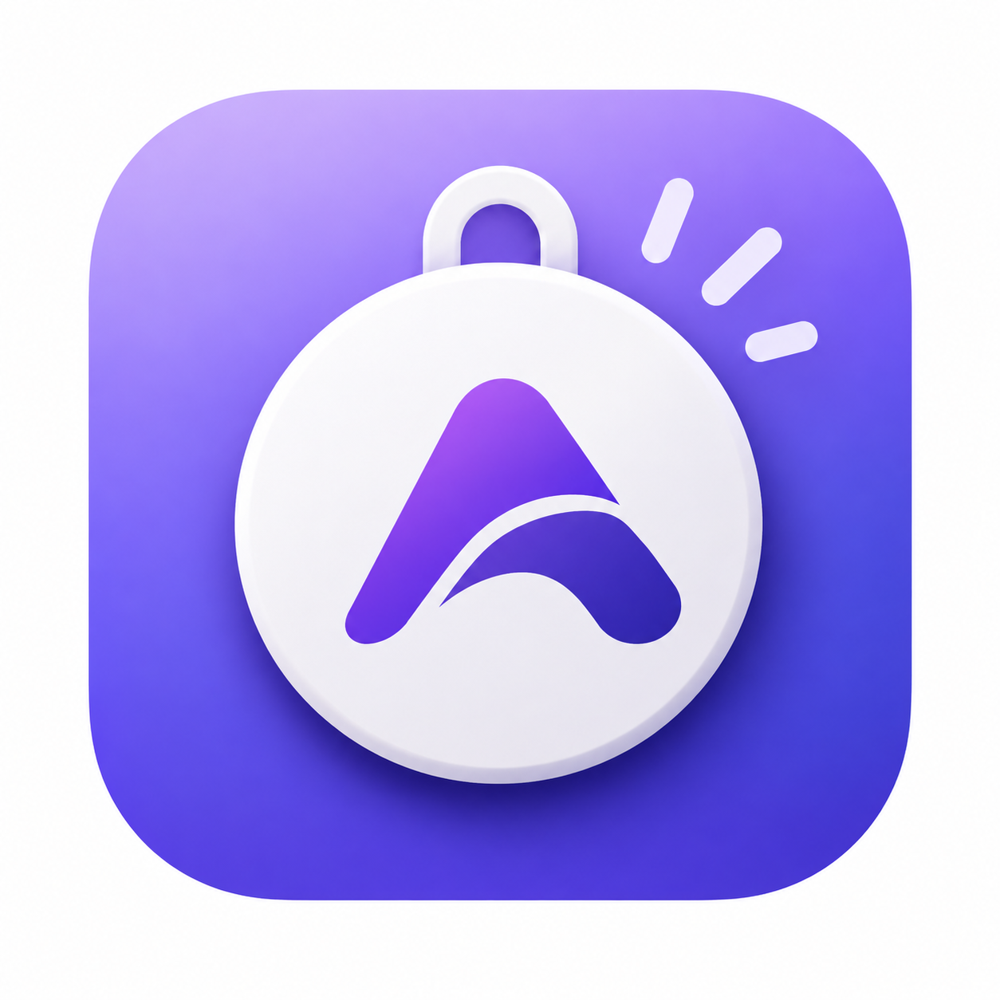

<p align="center"></p>

# Amuless

Amulet + Limitless = **Amuless**。
LimitlessPendant 用の個人向け Android アプリです。

## omi について

このリポジトリは [BasedHardware/omi](https://github.com/BasedHardware/omi)(MIT License)のフォークで、Android アプリ(`app/`)を改変して使っています。元の README は [README.omi.md](README.omi.md)、ライセンスは [LICENSE](LICENSE) にあります。omi の開発者の皆さんに感謝します。

## 目的

LimitlessPendant のサービスは 2025/12/1 に終了します。omi アプリに移行すると正しく動作しましたが、ペンダントから常時ストリーミングして文字起こしするため、スマホのバッテリー消費が大きくなります。
Amuless は常時ストリーミングをやめ、指定した時刻(深夜)にペンダントの音声データをまとめて取り出して文字起こしします。

## 全体の流れ

1. LimitlessPendant とペアリングする
2. 指定時刻に、ペンダントから音声データを取り出す
3. Tailscale 経由で自宅 MacBook の mlx-whisper に送り、文字起こしする
4. 文字起こしを API キーで自作 Web アプリ「memoria」に保存する
5. 要約は別のツール(muse)が担当する

omi が提供するクラウドサービス(バックエンド、文字起こし、アカウント、課金など)は使いません。

## 開発状況

開発中です。ペンダントとのペアリング、毎日決まった時刻(既定 2:00)の音声取り込み、Opus から WAV への変換、mlx-audio での文字起こし、memoria への保存まで実装しています。

### 設定

アプリの設定画面で次を入力します。

- 文字起こしサーバー: mlx-audio の OpenAI 互換 API(`http://<MacのTailscale IP>:8000/v1`)
- memoria の URL と API トークン(トークンは端末の暗号化領域に保存します)

スマホで Tailscale をオンにしておく必要があります。Mac 側のサーバーは、Tailscale から届くよう `0.0.0.0` などで待ち受けてください。

### ビルド

Flutter 3.44.5 と JDK 21、Android SDK が必要です。

```sh
cd app
flutter build apk --release
```

## Tailscale と Android の設定

文字起こしは、自宅の Mac の mlx-audio に、Tailscale 経由でつなぎます。スマホの Tailscale は、画面のスイッチがオンでも、実際には接続が切れていることがあります(特に Xiaomi の HyperOS)。夜の自動実行が失敗しないよう、次の設定をしておいてください。

- **Tailscale を「常時接続の VPN」にする。** Android の設定 → VPN → Tailscale の歯車 → 「常時接続の VPN」をオン。切れたときに、OS が自動で立て直します。
- **鍵の有効期限を無効にする。** Tailscale の管理画面で、このスマホの「Disable key expiry」を選ぶ。期限切れでログインが外れるのを防ぎます。
- **Tailscale と Amuless の両方で、バックグラウンドの制限を外す。** Android の電池の最適化を除外し、HyperOS ではマルチタスク画面でアプリを「ロック」し、「自動起動」を許可する(Amuless 側の記録は [docs/PENDANT.md](docs/PENDANT.md) を参照)。
- 設定画面の Whisper の URL は、Mac の Tailscale の IP(`100.x.x.x`)にしておくと、家の中でも外でも同じ URL でつながります。家の中なら Tailscale は自動で直接つながります。

Mac に届かないときは、2 分ごとに自動でやり直し、画面に「Whisper サーバー(Mac)につながりません」と理由を出します。

## ペンダントの解析メモ

ボタンの操作、LED、通信の中身、Xiaomi(HyperOS)での注意点は、[docs/PENDANT.md](docs/PENDANT.md) にまとめています。
HyperOS では、アプリが勝手に終了することがあります(原因は調査中)。電池の最適化の除外、マルチタスク画面での「ロック」、「自動起動」の許可を、設定しておいてください。

## 注意

個人開発のため、**Issue と Pull Request は受け付けていません**。
